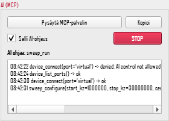
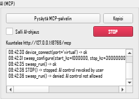

# MCP: NanoVNA-Saver LLM-mallien käyttöön

Saverin sisällä toimii [MCP](https://modelcontextprotocol.io)-palvelin. Sen kautta LLM-malli
(Claude Code, Claude Desktop, paikallinen malli MCP-asiakkaan kautta) voi käyttää
Saverin toimintoja: kytkeä laitteen, asettaa ja ajaa pyyhkäisyn, lukea tulokset, ottaa
kaaviokuvia, ajaa analyyseja ja kalibroida ihmisen kanssa.

Epic: Missing-LinkZeroOne/litevna-openvna#87 (issuet #88–#94).

## Asennus

```bash
pip install -e ".[mcp]"        # tai: pip install "mcp>=1.12,<3" uvicorn
```

Ilman `mcp`-pakettia Saver toimii kuten ennenkin. AI-paneelissa näkyy silloin asennusohje.

## Käyttö

### A. Saver auki, malli ohjaa (suositus)

1. Käynnistä Saver tavalliseen tapaan. Vasemmassa sarakkeessa on **AI (MCP)** -paneeli.
2. Paina **Käynnistä MCP-palvelin**. Palvelin kuuntelee osoitteessa `http://127.0.0.1:8765/mcp`.
   Tunniste (token) tallentuu tiedostoon `~/.nanovna-saver/mcp.json`.
3. Paina **Kopioi**. Leikepöydälle tulee Claude Code -komento:
   ```bash
   claude mcp add --transport http nanovna-saver http://127.0.0.1:8765/mcp --header "Authorization: Bearer <token>"
   ```
4. Ruksaa **Salli AI-ohjaus**. Ilman ruksia malli voi vain lukea tietoja.

Komentoriviltä sama käynnistyy valitsimilla `python -m NanoVNASaver --mcp http [--mcp-port 8765] [--mcp-allow]`.

Claude Desktop ja muut pelkkää stdio-yhteyttä tukevat asiakkaat saa kytkettyä HTTP-palvelimeen
yleisellä sillalla, esim. `npx mcp-remote http://127.0.0.1:8765/mcp --header "Authorization: Bearer <token>"`.
Toinen vaihtoehto on tila B.

### B. Ikkunaton (asiakas käynnistää Saverin)

```json
{
  "mcpServers": {
    "nanovna-saver": {
      "command": "python",
      "args": ["-m", "NanoVNASaver", "--headless", "--mcp", "stdio"],
      "env": {"PYTHONPATH": "/polku/modded-nanovna-saver/src"}
    }
  }
}
```

Ikkunattomassa tilassa AI-ohjaus on sallittu, koska käyttäjä käynnisti Saverin
nimenomaan mallia varten. Tiedostojen tallennus kysytään silloin asiakkaan kautta
(elicitation). Jos asiakas ei tue kysymistä, tallennus estetään, ja malli saa
virheen "Kuittausta ei voitu pyytää…" (ei "käyttäjä ei hyväksynyt"), jotta se ei
luule ihmisen kieltäytyneen.

### C. Ilman laitetta: virtuaalilaite

`--virtual` lisää porttilistaan laitteen `virtual`. Se simuloi antennia, jonka resonanssi
on 14,2 MHz (S11), ja 145 MHz:n kaistanpäästösuodatinta (S21). Kun valitsimelle antaa
tiedoston (`--virtual mittaus.s2p`), virtuaalilaite toistaa sitä. Virtuaalilaitteella voi kehittää ja
testata, vaikka oikea laite ei vielä tunnistu (#19).

Virtuaalilaitteella on myös simuloitu 480 × 320 -näyttö, joten `device_screenshot` toimii
ilman laitetta. Kuvassa on viimeisimmän pyyhkäisyn alueen S11-käyrä (0 … −40 dB) ilman
kohinaa: sama alue antaa aina saman kuvan, joten testit voivat verrata sitä referenssiin.
Kuva ei jäljittele LiteVNA64:n oikeaa käyttöliittymää.

```bash
python -m NanoVNASaver --virtual --mcp http --mcp-allow
```

### D. Etäkone SSH:n yli

Laite on kytketty toiseen koneeseen (esim. testikone, litevna-openvna#156). Malli ajetaan
omalla koneella. Saver asennetaan etäkoneelle käyttäjän omaan venviin
(`~/venv/bin/pip install -e ".[mcp]"`), ja kirjautumisen pitää toimia SSH-avaimella ilman
salasanaa.

**Ensisijainen tapa: stdio SSH:n yli.** Asiakas käynnistää Saverin etäkoneelle ssh:lla:

```bash
claude mcp add litevna-testikone -- ssh -T -o BatchMode=yes \
  -o ServerAliveInterval=15 -o ServerAliveCountMax=3 \
  <käyttäjä>@<etäkone> ~/venv/bin/python -m NanoVNASaver --headless --mcp stdio
```

- `-T`: ei päätettä. Pääte sekoittaisi rivinvaihdot ja protokollan.
- `BatchMode=yes`: jos avain puuttuu, yhteys epäonnistuu heti eikä jää odottamaan salasanaa.
- `ServerAliveInterval`: jos verkko katkeaa, asiakas huomaa sen noin 45 sekunnissa.
- `--headless` asettaa Qt:n offscreen-tilaan, joten etäkoneella ei tarvita näyttöä.

stdoutiin menee vain JSON-RPC. Saver siirtää kaiken muun tulosteen stderriin heti
käynnistyksen alussa (`MCP/stdio_wire.py`). Tähän kuuluvat print-lauseet sekä Qt:n ja
C-kirjastojen viestit. Claude Code näyttää stderrin MCP-lokissa. Debug-lokin saa valitsimella
`--debug-file`.

Kun yhteys katkeaa, Saver vapauttaa laitteen ja sammuu itse. Tämä tapahtuu, kun stdin
sulkeutuu (ssh päättyy) tai prosessi saa SIGTERMin tai SIGHUPin: pyyhkäisy pysäytetään,
sarjaportti suljetaan ja paluukoodi on 0. Testi: `tests/test_mcp_stdio.py`.
Jos verkko katkeaa niin, ettei etäkone huomaa sitä, sshd pitää Saverin käynnissä TCP:n
aikakatkaisuun asti. Etäkoneen `/etc/ssh/sshd_config`:iin kannattaa siksi lisätä
`ClientAliveInterval 15` ja `ClientAliveCountMax 3`. Laitelukko (litevna-openvna#188,
Saver PR #14) on `flock`, joten se vapautuu aina, kun prosessi päättyy, myös `kill -9`:llä.

Tallennetut tiedostot jäävät etäkoneen työhakemistoon (`~/NanoVNASaver-MCP`).
Kuvakaappaukset ja kaaviot tulevat vastauksen mukana.

**Vaihtoehto: HTTP ja SSH-tunneli.** Tätä tapaa kannattaa käyttää, kun Saver jää etäkoneelle
käyntiin usean asiakasyhteyden ajaksi.

```bash
# etäkoneella (esim. tmuxissa)
~/venv/bin/python -m NanoVNASaver --headless --mcp http
# omalla koneella: tunneli ja tunniste
ssh -N -L 8765:127.0.0.1:8765 <käyttäjä>@<etäkone> &
ssh <käyttäjä>@<etäkone> cat .nanovna-saver/mcp.json
claude mcp add --transport http litevna-testikone http://127.0.0.1:8765/mcp \
  --header "Authorization: Bearer <token>"
```

HTTP kuuntelee etäkoneella vain osoitteessa 127.0.0.1, joten siihen pääsee vain tunnelin
kautta, ja tunniste tarvitaan silti. Tunniste vaihtuu joka käynnistyksellä.

## Turvallisuus

| AI ohjaa | STOP painettu |
|---|---|
|  |  |


| taso | mitä | ehto |
|---|---|---|
| **read** | tilan ja datan lukeminen, kaaviot, analyysit | aina, kun palvelin on käynnissä |
| **act** | kytkentä, pyyhkäisy, asetukset, markkerit, kalibrointi | käyttäjä on sallinut AI-ohjauksen |
| **persist** | tiedostojen tallennus (Touchstone, .cal) | lisäksi käyttäjän kuittaus joka kerta |
| — | firmware, flashaus, laitteen asetusmuistit | ei MCP:ssä lainkaan |

- **STOP** (paneelin punainen painike tai Ctrl+Shift+S) pysäyttää pyyhkäisyn ja ottaa
  AI-ohjauksen heti pois. Ohjaus pitää sallia uudelleen.
- Kun malli ohjaa, paneelissa näkyy "AI ohjaa: <työkalu>". Kaikki kutsut kirjataan paneelin
  lokiin ja tiedostoon `~/.nanovna-saver/mcp-log.jsonl`.
- Vain yksi muuttava toiminto voi olla kerrallaan käynnissä. Jos käyttäjän oma pyyhkäisy
  on käynnissä, malli saa vastauksen "odota".
- Tiedostoja luetaan ja kirjoitetaan vain työhakemistossa `~/NanoVNASaver-MCP`
  (valitsin `--mcp-dir`).
- HTTP kuuntelee vain osoitteessa 127.0.0.1 ja vaatii tunnisteen. Selainpyynnöt muista
  origineista hylätään.
- Kalibroinnissa malli ei voi ohittaa ihmistä: jokainen standardi kysytään erikseen
  ("kytke SHORT"), ja mittaus alkaa vasta kuittauksen jälkeen.
- **Laitelukko.** Kun Saver kytkeytyy oikeaan laitteeseen (GUI:n Connect tai `device_connect`), se ottaa
  saman koneenlaajuisen lukon kuin litevna-openvna:n `tools/vna_lock.py` ja vapauttaa sen, kun yhteys
  katkaistaan. Jos lukko on varattu, kytkentä hylätään ja viestissä näkyy pitäjä ja tarkoitus
  (esim. `lfai@marko pid 1234, 40 s, tarkoitus: savutesti`). Rescan ei avaa portteja, kun joku muu pitää
  lukkoa: laite näkyy listassa merkinnällä "(varattu)". Virtuaalilaite ei ota lukkoa. Lukon muoto
  (polku, `flock`/`msvcrt`, `.holder`-tiedosto, `LITEVNA_LOCK_HELD`) on kuvattu tiedostossa
  `src/NanoVNASaver/device_lock.py`, ja sen määrää `vna_lock.py`.
- Työkalu hylkää parametrit, joita sillä ei ole ("Tuntematon parametri X. Työkalun Y
  sallitut parametrit: …"), ja skeemoissa on `additionalProperties: false`. Ilman tätä
  arvattu parametri (esim. `marker_add(freq_hz=…)`) ohitettaisiin hiljaa ja malli
  luulisi sen toimineen.

## Mitä mallilla on käytössä

**Työkalut** (46) generoidaan toimintorekisteristä (`src/NanoVNASaver/MCP/api.py`, `@action`).
Ryhmät:

- **device**: `device_list_ports`, `device_connect`, `device_disconnect`, `device_info`,
  `device_wait`, `device_set_datapoints`, `device_set_bandwidth`, `device_set_validation`,
  `device_screenshot`, `device_shell`, `device_shell_act`, `device_shell_persist`,
  `device_input` (ks. alla)

**Laitteen seuranta (litevna-openvna#190).** Kun LiteVNA on kytketty, Saver seuraa sen
USB-porttipolkua (esim. `1-1`) puolen sekunnin välein (`MCP/device_watch.py`,
`Hardware/usb_state.py`). Laite tunnistetaan porttipolusta, ei portin nimestä, koska
sovelluksella, valmistajan bootloaderilla ja Storage-tilalla on sama VID:PID `04b4:0008` ja
sarjanumero `ZN406001` on kaikissa yksilöissä sama.

| tila | miltä näyttää USB:ssä |
|---|---|
| `app` | `04b4:0008` ja CDC-sarjaportti |
| `vendor_bl` | `04b4:0008`, tuote "CDC-ACM Demo" (tumma näyttö, päivitystila) |
| `storage` | `04b4:0008`, pelkkä massamuisti, ei sarjaporttia |
| `rom_dfu` | `2e3c:df11` (BOOT0) |
| `loader` | varattu: loaderilla ei vielä ole USB:tä (#184) |
| `gone` | ei mitään siinä portissa |

- Kun laite poistuu sovellustilasta (reset, päivitystila, Storage, irrotus), kesken oleva
  pyyhkäisy epäonnistuu heti ja virheessä kerrotaan havaittu tila. Sarjaportti suljetaan,
  ja asiakkaille lähetetään `saver://device`-päivitysilmoitus ja lokiviesti.
- Kun sama porttipolku näyttää taas sovelluksen, Saver yhdistää itse, vaikka portin nimi
  olisi vaihtunut. Jos käyttäjä irrottaa yhteyden itse (painike tai `device_disconnect`),
  seuranta loppuu.
  - Saver yhdistää vasta, kun portti on ollut näkyvissä 1,5 s ja tunnistus antaa saman
    laitetyypin kuin ensimmäisellä kerralla (esim. H4). Oikealla laitteella CDC-portti tulee
    näkyviin ennen kuin komentotulkki vastaa. Silloin tunnistus antaa "Unknown", ja kaikki
    pyyhkäisyt epäonnistuvat.
  - Linuxin USB-laitenumero vaihtuu jokaisessa enumeroinnissa. Siksi myös nopea
    uudelleenkäynnistys, joka ehtii valmiiksi kahden tarkistuksen välissä, havaitaan.
- `device_wait(state, timeout_s, expect_change)` odottaa haluttua tilaa. `app` palaa vasta,
  kun laite on taas kytketty ja vapaa, joten `sweep_run` toimii heti sen jälkeen. Jos
  Saver ei ole vielä yhdistänyt laitteeseen, `app` tarkoittaa pelkkää USB-tilaa.
  `device_info` kertoo USB-tilan kentässä `usb`.
- `expect_change=true` heti uudelleenkäynnistävän komennon (reset, flashaus) jälkeen:
  laite pysyy USB:ssä vielä hetken (oikealla laitteella 0,05–1,9 s), joten odotuksen täytyy
  ensin nähdä sen poistuvan. Ilman tätä `app` palasi heti 0,0 sekunnissa.
- Oikea laite 11.11. (main `d521d9e`): `reset` → `device_wait("app", expect_change=true)` →
  `sweep_run` onnistui 10/10, noin 21,5 s kierros. Storage-kulku 4/4: Storage
  tunnistetaan, kytketyn laitteen katoaminen havaitaan 9,2 s:ssa, ja Control-tilaan
  palattua Saver yhdistää uudelleen ja mittaa.
- Linuxilla tila luetaan `/sys/bus/usb/devices`-hakemistosta, josta näkyvät kaikki tilat.
  Muilla käyttöjärjestelmillä näkyvät vain sarjaportit, joten `storage` ja `rom_dfu`
  näkyvät tilana `gone`.
- **sweep**: `sweep_get`, `sweep_configure`, `band_list`, `sweep_set_band`,
  `sweep_set_attenuator`, `sweep_run`, `sweep_stop`, `sweep_segmented`
- **data**: `data_summary`, `data_points`, `data_at` (arvo yhdellä taajuudella, interpoloitu mitattujen pisteiden välillä; virhe, jos taajuus on pyyhkäisyn ulkopuolella), `reference_set`, `reference_reset`
- **markers**: `marker_list`, `marker_set`, `marker_add`, `marker_remove`
- **analysis**: `analysis_list`, `analysis_run`, `tdr_result`
- **charts**: `chart_list`, `chart_image` (PNG)
- **files**: `file_list`, `file_load_sweep`, `file_load_reference`, `file_export_touchstone`
- **calibration**: `calibration_status`, `calibration_capture`, `calibration_apply`,
  `calibration_reset`, `calibration_set_offset_delay`, `calibration_load`, `calibration_save`

Työkalut palauttavat **yhteenvedon** (esim. pienin VSWR, resonanssit, VSWR ≤ 2 -kaistat).
`sweep_run`- ja `data_summary`-yhteenvedossa S21:n −3 dB -kaista on
`s21.minus_3db = {start_hz, stop_hz, bandwidth_hz, center_hz, edges_interpolated,
open_low, open_high}`:

- kaista on yhtenäinen alue maksimin ympärillä (vahvistus ≥ max − 3 dB); muut piikit
  kaistan ulkopuolella eivät venytä sitä
- reunat on interpoloitu lineaarisesti −3 dB:n ylityskohtaan, joten ne ovat
  pisteresoluutiota tarkempia
- `center_hz` on reunojen geometrinen keskiarvo √(f1·f2)
- jos kaista jatkuu pyyhkäisyn reunan yli, `open_low`/`open_high` on `true` ja kyseinen
  reuna sekä `bandwidth_hz` ja `center_hz` ovat `null`: levennä pyyhkäisyä

S11:n `vswr_le_2`- ja `vswr_le_1_5`-alueilla on jo `bandwidth_hz` (reunat pisteresoluutiolla).
Täysi data on saatavilla **resursseina**, jotta mallin konteksti ei täyty tuhansista pisteistä:

- `saver://sweep/latest.s1p`, `saver://sweep/latest.s2p`: koko mittaus Touchstone-muodossa
- `saver://sweep/summary`, `saver://sweep/settings`, `saver://device`,
  `saver://calibration`, `saver://markers` (JSON)
- `saver://ai-log`: mitä malli on tehnyt tässä istunnossa

**Promptit** ovat valmiita mittausreseptejä: `antenna(start_hz, stop_hz)`,
`filter(start_hz, stop_hz)`, `cable_length`, `compare`.

### Laitteen komentorivi: `device_shell*`

Saver varaa sarjaportin, joten malli ei pääse laiteohjelmiston omiin diagnostiikkakomentoihin
muuten. Kolme työkalua lähettää **yhden sallitun komennon** jo avattuun porttiin Saverin
sarjaporttilukon alla. Vapaata komentoriviä ei ole: komennon pitää täsmätä sallittujen listaan
(`src/NanoVNASaver/MCP/shell_allowlist.py`, jokaisella rivillä on perustelu). Listaamaton komento
hylätään, samoin `;`, `|`, `&`, rivinvaihdot ja muut erikoismerkit.

| työkalu | riski | esimerkkejä |
|---|---|---|
| `device_shell` | read | `version`, `info`, `sweep-stats`, `sd stats`, `cal why`, `msc log`, `usb status`, `sweep`, `power` |
| `device_shell_act` | act (AI-ohjaus sallittu) | `sweep 50000000 1500000000 201`, `sweep-avg 4`, `ref on`, `s21 on`, `s21 norm`, `power 2`, `cal off`, `recall 1` |
| `device_shell_persist` | persist (käyttäjä kuittaa joka kerta) | `save 2` (ylikirjoittaa kalibrointislotin), `meas save`, `meas note <teksti>` |

- Työkalu hylkää komennon, jos se kuuluu toiseen luokkaan, ja kertoo oikean työkalun nimen.
- Toimii vain Missing Linkin laiteohjelmistolla (`version` vastaa `proto 1.x`), ei käynnissä olevan pyyhkäisyn aikana.
- Aina kielletty (`NEVER_RULES`, tarkistetaan ennen sallittujen listaa, oma virheviesti syineen): `reset` kaikkine
  muotoineen (`reset dfu`, `reset update`), `config-reset`, `usb mode …`, `dfu`, `bootloader`. Nämä jättävät laitteen
  tilaan, josta pääsee pois vain laitteen ääressä (litevna-openvna#186, #176). Turvalliset etäversiot tulevat
  issueista #175 (USB-tila ajastimella) ja #179 (`reset loader`).
- Ei listalla, joten hylätään: `sd read`, rekisteri- ja pinnikomennot, `clk-set`
  (omistaja päättää, kuuluuko se listaan) ja kalibrointistandardien `cal open|short|load`
  (käytä `calibration_capture`, joka pyytää ihmistä kytkemään standardin).
- Vastaus: `{command, output, truncated, error, ms}`; `error` on tosi, jos laite vastasi `?`-rivillä.
- `cal on` ei ole listalla: laiteohjelmisto asettaa lipun tarkistamatta, että voimassa oleva kalibrointi on olemassa
  (litevna-openvna#144). `cal off` ja `recall <0-4>` riittävät.
- Painike-, kosketus- ja rulla-tapahtumat (`input key|ptr|wheel`) eivät ole `device_shell`-komentoja. Ne lähetetään
  erillisellä työkalulla `device_input` (ks. alla).

### Laitteen käyttöliittymän ohjaus: `device_input`

`device_input` lähettää **yhden syötetapahtuman** laitteen omalle käyttöliittymälle: `input key <hex> <hex> up|down`
(HID-käyttökoodi ja muokkaimet; `input key 28 00 down` ja `... up` on SELECT, `4f` = oikea, `50` = vasen),
`input ptr <x> <y> down|up|move` (kosketus, näyttö 480x320) ja `input wheel <n>`. Muut komennot hylätään.

**Tärkeää: käyttöliittymän kautta pääsee kaikkeen, mitä laitteen valikko tekee.** Siihen kuuluvat myös asiat,
jotka `device_shell`-lista sulkee pois: DFU-tilaan siirtyminen (bootloader), kalibroinnin tallennus flashiin ja
USB-tilan vaihto. **Storage-tila poistaa laitteen COM-portin**, jolloin Saver menettää laitteen eikä malli pääse
takaisin: paluu vaatii ihmisen laitteen valikossa (USB → Control).

Siksi `device_input` vaatii kaksi lupaa:

1. **AI-ohjaus sallittu** (kuten muutkin ACT-toiminnot).
2. **Erillinen lupa "Salli tekoälyn ohjata laitteen käyttöliittymää"**, jonka käyttäjä antaa Saverin AI (MCP) -paneelista
   **kerran per laiteyhteys**. Lupa ei seuraa AI-ohjauksesta. Se raukeaa, kun yhteys katkeaa tai laite kytketään uudelleen,
   kun AI-ohjaus otetaan pois ja kun käyttäjä painaa STOP. Sitä ei voi antaa ilman AI-ohjausta tai kytkettyä laitetta.
   Headless-tilassa lupaa ei anneta automaattisesti: `--mcp-allow` koskee vain AI-ohjausta.

Kun lupa on voimassa, paneelissa näkyy koko ajan punainen teksti "LAITTEEN KÄYTTÖLIITTYMÄN OHJAUS PÄÄLLÄ". Ilman lupaa
`device_input` hylätään (loki: `denied`) eikä laitteelle lähetetä mitään. Jokainen syötetapahtuma kirjataan AI-lokiin kuten
muutkin toiminnot, ja luvan antaminen ja raukeaminen kirjataan riveillä `ui_control`.


## Kehittäjälle

- Uusi toiminto lisätään metodina `SaverAPI`:in ja merkitään `@action`. Docstring on se
  teksti, jonka malli lukee, joten kirjoita siihen mitä toiminto tekee, yksiköt ja mitä se
  palauttaa.
- Jokainen GUI-painike on kirjattu tiedostoon `MCP/inventory.py`: joko MCP-toiminto tai
  perusteltu poisjättö. `tests/test_mcp_inventory.py` kaatuu, jos uudelle painikkeelle ei
  ole tehty päätöstä.
- Toiminnot ajetaan Qt:n pääsäikeessä (`MCP/bridge.py`). Palvelimen säikeestä ei saa koskea
  widgetteihin suoraan.
- `tests/test_mcp_e2e.py` ajaa MCP-asiakkaan virtuaalilaitetta vastaan (yhdistäminen,
  pyyhkäisy, kuvat, kuittaukset, kalibrointi, STOP).
- `tests/test_mcp_panel.py` käy AI-paneelin läpi oikeassa pääikkunassa (palvelinnappi,
  Kopioi, "Salli AI-ohjaus", tila AI:n toimiessa, STOP, Ctrl+Shift+S, loki).
  `MCP_PANEL_SHOTS=<kansio>` tallentaa paneelista kuvan jokaisessa vaiheessa
  (offscreen-tilassa lisää `QT_QPA_FONTDIR`, esim. `C:/Windows/Fonts`, muuten tekstit
  ovat laatikoita).

## Arviointisarja: kuinka usein malli onnistuu

`tests/mcp_eval/` mittaa oikealla mallilla, kuinka usein se saa tehtävän oikein näillä
työkaluilla. Jokainen ajo käynnistää puhtaan ikkunattoman Saverin virtuaalilaitteella,
antaa mallille yhden tehtävän, kaikki MCP-työkalut ja Saverin palvelinohjeet (kuten oikeat
asiakkaat), ja tarkistaa vastauksen.

| tehtävä | mitä kysytään | toleranssi | mittauksen on katettava |
|---|---|---|---|
| `antenni_resonanssi` | taajuus, jolla antennin VSWR on pienin 3–30 MHz | ±1 % | resonanssi |
| `antenni_vswr` | pienin VSWR | ±0,05 | resonanssi |
| `suodatin_keskitaajuus` | taajuus, jolla S21 on suurin 100–200 MHz | ±1 % | keskitaajuus |
| `suodatin_kaista` | −3 dB:n kaistanleveys | ±5 % | keskitaajuus |
| `suodatin_vaimennus` | S21 annetulla taajuudella | ±0,2 dB | kysytty taajuus |
| `markkeri_resonanssiin` | markkeri 1 pienimpään VSWR:ään (tarkistetaan Saverin tilasta) | ±1 % | resonanssi |

**Laite arvotaan jokaiseen ajoon.** Ajo *i* käynnistää Saverin `--virtual-seed <seed+i>`,
jolloin antennin resonanssi (4–28 MHz), resistanssi, Q, syöttökaapeli sekä suodattimen
keskitaajuus (115–185 MHz), Q ja vahvistus arvotaan siemenestä
(`VirtualVNA.Params.from_seed`). Oikeat vastaukset lasketaan samoista parametreista
(`VirtualVNA.model`), ei kirjoiteta käsin. Kiinteällä laitteella (14,2 MHz, 20 metrin
bändi) malli voisi vastata oikein muistista. Sama siemen kaikille malleille, joten mallit
kohtaavat samat laitteet. Siemen tallentuu riville.

**Oikea arvo ei riitä, sen on oltava mitattu.** `pass` vaatii, että vastaus on toleranssissa
**ja** pyyhkäisy kattoi taajuuden, josta vastaus riippuu. Pyyhkäisyksi lasketaan
`sweep_run` ja myös `device_connect`, joka pyyhkäisee laitteen nykyisen alueen
(virtuaalilaitteella 3,6–30 MHz) ja palauttaa yhteenvedon. Muuten tulos on
`fail` syyllä `ei mitattu (arvaus osui)` tai `ei mitattu`. Muut syyt: `väärä arvo` ja
`ei vastausta`. Yhteenvedon sarake "arvaus osui" laskee arvaukset, jotka vanha tarkistin
olisi hyväksynyt.

Malli vastaa rivillä `VASTAUS: <luku> <yksikkö>`.

```
python tests/mcp_eval/run_eval.py --model qwen3-coder:30b \
    --base-url http://<ollama>:11434 --n 10 --jobs 3 --out tulokset.jsonl
python tests/mcp_eval/run_eval.py --summary tulokset.jsonl
```

- `--backend ollama` (oletus) käyttää Ollaman omaa rajapintaa ja asettaa kontekstin
  (`--num-ctx`, oletus 32768), koska 41 työkalun kuvaukset eivät mahdu 4k:n oletukseen.
  `--backend openai` + `--base-url …/v1` + `--api-key-env <muuttuja>` toimii minkä tahansa
  OpenAI-yhteensopivan rajapinnan kanssa (avain luetaan ympäristömuuttujasta).
- Jokainen ajo tallentuu JSONL-riviksi: malli, tehtävä, siemen, totuus, vastaus,
  pyyhkäisyjen alueet, kutsutut työkalut, vuorot, tokenit, kesto ja `reason`.
- Tulos on **kolme tilaa**: `pass`, `fail` (malli vastasi väärin, ei vastannut tai ei
  mitannut) ja `error` (ajo itse hajosi: mallipalvelin, Saver tai aikaraja). Virhe-ajot
  raportoidaan erikseen eikä niitä lasketa mallin onnistumisiin tai epäonnistumisiin.
- Yhteysvirhe mallipalvelimeen (`URLError`, `ConnectionResetError` …) yritetään kerran
  uudelleen, ja rivin `retried`-kenttä kertoo sen. Aikakatkaisua ei uusita: se voi olla
  mallin hitautta.
- `--ohje off` poistaa järjestelmäkehotteesta lauseen "Mittaa aina itse työkaluilla; älä
  arvaa." A/B-koe: auttaako kehotus mallia mittaamaan. Rivin `ohje`-kenttä kertoo
  kumpi.
- Raportoi aste (esim. 8/10), ei kyllä/ei. n = 10 ei erota 90 %:a 100 %:sta.
- `--jobs` > 1 ajaa ajoja rinnakkain (kukin oma Saver). Kesto sisältää silloin myös
  mallipalvelimen jonon, joten kestoja ei voi verrata eri `--jobs`-arvoilla.
- `tests/mcp_eval/test_eval_tasks.py` (CI) tarkistaa oikeat vastaukset ja jäsentimen
  ilman mallia.

## Ei vielä tehty

- Arviointisarjan ajo pilvimallilla (ajuri tukee, avain puuttuu) ja kalibrointitehtävä,
  jossa vahvistus simuloidaan.
- Kaistataulukon muokkaus, mittaustiedostoihin perustuvat kalibrointistandardit ja
  kalibrointisarjojen tallennus (rajattu pois, ks. `inventory.py`).
- Oikealla LiteVNA:lla todentaminen, joka odottaa laitteen tunnistusta (#19).
